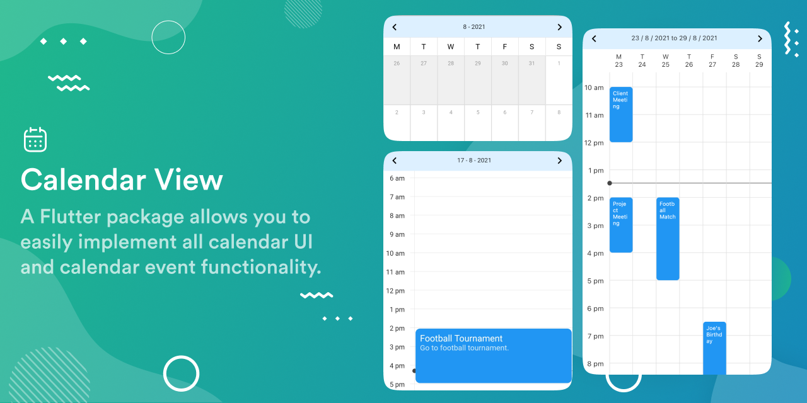
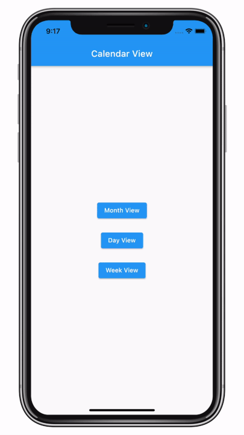

# Calendar View

[](https://pub.dev/packages/calendar_view)
[](https://github.com/SimformSolutionsPvtLtd/flutter_calendar_view/blob/main/LICENSE)

A Flutter package that allows you to easily implement all calendar UI and calendar event
functionality in your application.

_Check out other amazing
open-source [Flutter libraries](https://pub.dev/publishers/simform.com/packages)
and [Awesome Mobile Libraries](https://github.com/SimformSolutionsPvtLtd/Awesome-Mobile-Libraries)
developed by Simform Solutions!_

## ⚠ Note

All 2.x.x releases may include breaking changes. To avoid unexpected issues, do not use the
caret (^) when depending on any versions of 2.x.x Instead, pin the exact version.

Example:

```yaml
dependencies:
  calendar_view: 2.0.0
```

## Preview



## Features

- Multiple calendar view options:
    - Month View
    - Day View
    - Week View
- Highly customisable UI components
- Manage events (add, remove, update)
- Manage reminders (add, remove, update)
- Manage full-day events (add, remove, update)
- Show working days in week view and day views
- Sync event data between multiple views

## Documentation

Visit our [documentation](https://simform-flutter-packages.web.app/calendarView) site for all
implementation details, usage instructions, code examples, and advanced features.

## Installation

1. Add dependency to your `pubspec.yaml`:

```yaml
dependencies:
  calendar_view: <latest-version>
```

## AI agent skills

This package ships [agent skills](https://dart.dev/tools/pub/package-skills) for coding agents
(Claude Code, Cursor, Copilot, Codex, …):

| Skill                       | Use it to                                                                        |
|-----------------------------|----------------------------------------------------------------------------------|
| `calendar-view-events`      | Create, update, filter and recur events with `EventController`                   |
| `calendar-view-views`       | Add and control `MonthView`, `DayView`, `WeekView`, `MultiDayView`, `ScheduleView` |
| `calendar-view-theming`     | Theme, style headers and translate the calendar                                  |
| `calendar-view-migration`   | Migrate an app from `calendar_view` 2.0.0 to 3.x                                 |

Install them from your app's root directory (the `skills` tool needs a recent Dart SDK, which may be
newer than the minimum SDK this package supports):

```bash
dart run skills@ get
```

Only packages that are direct dependencies of your app are scanned. Run the command again after
upgrading `calendar_view` to update the skills.

## Support

For questions, issues, or feature
requests, [create an issue](https://github.com/SimformSolutionsPvtLtd/flutter_calendar_view/issues)
on GitHub or reach out via the GitHub Discussions tab. We're happy to help and encourage community
contributions.
To contribute documentation updates specifically, please make changes to the doc/documentation.md
file and submit a pull request.

## License

This project is licensed under the MIT License - see
the [LICENSE](https://simform-flutter-packages.web.app/calendarView/license) file for details.